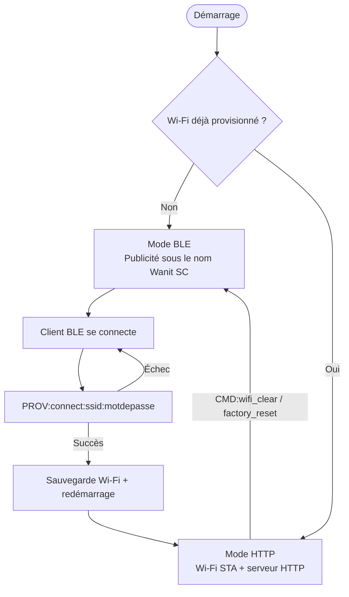

# Wanit Gateway


Firmware compilé pour le **Wanit Gateway**, un pont ESP32-C6 entre BLE/Wi-Fi et UART. Il permet de provisionner l'appareil en Wi-Fi via BLE, puis d'échanger des données avec un microcontrôleur (ex. STM32) via HTTP, y compris pour des mises à jour firmware en pass-through binaire.

> Ce dépôt ne contient **que les binaires compilés et la documentation** de chaque version. Le code source du firmware n'est pas public pour le moment.

---

## Fonctionnalités

- **Provisioning BLE** (service Nordic UART) : scan et connexion Wi-Fi via commandes `PROV:`, sans écran ni clavier sur l'appareil.
- **Bascule automatique BLE → HTTP** une fois le Wi-Fi provisionné, avec reconnexion automatique en cas de coupure.
- **Pont UART sur HTTP** : envoi/réception de trames vers le microcontrôleur connecté, avec découverte réseau via mDNS.
- **Canal brut (raw) pour mises à jour STM32** : transfert binaire transparent UART ↔ HTTP/BLE, pour piloter un bootloader STM32 directement depuis une application cliente.
- **Mise à jour du firmware ESP32 à distance (OTA)** *(depuis v2.0.0)* : envoi de l'image depuis l'application, en HTTP (`POST /ota/upload`) ou en BLE, sans accès physique à l'appareil. Images signées (ECDSA P-256/SHA-256), double emplacement applicatif avec retour arrière automatique en cas d'échec empêchant ainsi tout risque de brique.
- **Authentification HTTP optionnelle** par jeton (`X-Auth-Token`).

Le détail complet du protocole (commandes, formats de trame, machine d'état) est fourni dans la documentation jointe à chaque release.

### Cycle de vie de l'appareil



---

## Télécharger

Toutes les versions sont disponibles dans l'onglet [**Releases**](https://github.com/Math0XK/wanit-gateway-releases/releases). Depuis la **v2.0.0**, chaque release contient :

| Fichier | Description |
|---|---|
| `esp32-ble-wifi-uart-bridge-full.bin` | Image complète (bootloader + partitions + firmware), à flasher par câble en une seule commande |
| `esp32-ble-wifi-uart-bridge-ota.bin` | Image signée pour mise à jour à distance, via `POST /ota/upload` ou BLE — ne pas flasher par câble |
| `esp32-ble-wifi-uart-bridge-full-debug.bin` | Variante debug (logs verbeux, câble uniquement) — expose des informations sensibles sur l'UART, à ne pas déployer en production |
| `manifest.json` | Version, taille et empreinte SHA-256 de l'image OTA |
| `SHA256SUMS.txt` | Empreintes de tous les binaires et archives de la release |
| `wanit-ota-tools.zip` | Clients OTA en Python (`ota_http.py`, `ota_ble.py`), utilisables comme implémentation de référence |
| `PROTOCOL.md` | Manifeste complet du protocole (BLE, HTTP, UART, formats de trame, machine d'état) |
| `INTEGRATION_GUIDE_FR.md` / `INTEGRATION_GUIDE_EN.md` | Guides d'intégration côté application cliente |
| `PATCH_NOTES_*.md` | Notes de version |

> Les fichiers `firmware.bin`, `bootloader.bin` et `partitions.bin` séparés ne sont plus disponibles depuis la **v1.2.0** ; `esp32-ble-wifi-uart-bridge-ota.bin`, `manifest.json`, `SHA256SUMS.txt` et `wanit-ota-tools.zip` sont nouveaux depuis la **v2.0.0**.

---

## Flasher le firmware

### Prérequis

```
pip install esptool
```

### image complète

Un seul fichier, une seule commande :

```
python -m esptool --chip esp32c6 --port <PORT> --baud 921600 write-flash 0x0 <chemin d'accès>\esp32-ble-wifi-uart-bridge-full.bin"
```

Remplace `<PORT>` par le port série de l'appareil (ex. `COM5` sur Windows, `/dev/ttyUSB0` sur Linux/macOS).

Après le flash, l'appareil redémarre en mode BLE (publicité sous le nom `Wanit SC`) s'il n'a pas encore été provisionné.

> ⚠️ **Migration vers v2.0.0** : la table de partitions change avec cette version. Un appareil déjà déployé en v1.2.x ou antérieur **ne peut pas** recevoir la v2.0.0 par OTA — un dernier flash par câble (`esp32-ble-wifi-uart-bridge-full.bin`) est obligatoire, une seule fois. Les identifiants Wi-Fi, l'UID, le nom et le token d'authentification sont conservés. Voir `PATCH_NOTES_v2.0.0.md` pour le détail.

### Mises à jour suivantes : par OTA (HTTP ou BLE)

Une fois en v2.0.0, plus besoin d'accès physique à l'appareil : l'application pousse l'image `esp32-ble-wifi-uart-bridge-ota.bin` (jamais la `-full.bin`, qui est refusée) via `POST /ota/upload` en HTTP ou une caractéristique GATT dédiée en BLE. Les images sont signées (ECDSA P-256/SHA-256) et l'appareil dispose de deux emplacements applicatifs : une image défaillante déclenche un retour automatique à la version précédente, sans intervention.

Pour tester sans écrire de code, les clients Python fournis dans `wanit-ota-tools.zip` :

```
python -m pip install -r requirements.txt
python ota_http.py --status                              # état du module
python ota_http.py esp32-ble-wifi-uart-bridge-ota.bin     # mise à jour en Wi-Fi
python ota_ble.py  esp32-ble-wifi-uart-bridge-ota.bin     # mise à jour en BLE
```

Détail complet du protocole OTA (routes HTTP, caractéristique BLE, codes d'erreur, suivi de progression) : voir `PROTOCOL.md` et `PATCH_NOTES_v2.0.0.md`, joints à la release.

---

## Documentation

- **Manifeste du protocole** (BLE, HTTP, UART, formats de trame, machine d'état) — fourni en pièce jointe de chaque release (`PROTOCOL.md`)
- **Guides d'intégration** FR/EN — pour les développeurs d'applications clientes
- **Notes de version** — changements et compatibilité entre versions

---

## Licence

Les binaires et la documentation publiés dans ce dépôt sont distribués sous licence **MIT** (voir [`LICENSE`](LICENSE)).

Cette licence couvre uniquement les artefacts publiés ici (binaires compilés et documentation). Le code source du firmware reste la propriété de Wanit et n'est pas couvert par cette licence.
